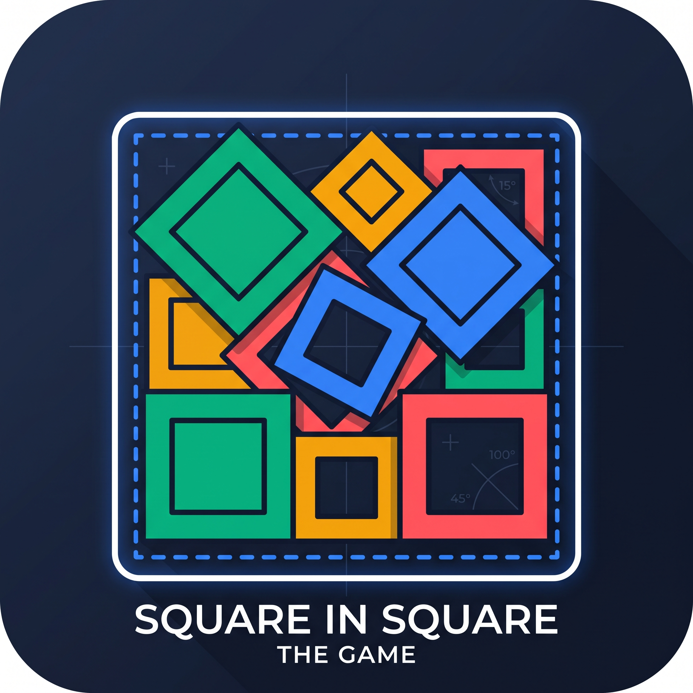

# Squares in Squares Solver

<p align="center">
  
</p>

[Play here](https://rnascunha.github.io/squares-in-squares/)

An interactive, client-side mathematical solver and visualizer designed to tackle the **Squares in Squares** geometric packing problem.

**The Goal:** Pack _N_ unit squares (side length = 1) into the smallest possible larger square container without overlapping.

## Features

- **Precise Geometric Engine:** Uses the Separating Axis Theorem (SAT) with a `1e-7` float tolerance for flawless continuous collision detection.
- **Interactive Dashboard:** Move squares freely with mouse dragging or use strict keyboard controls (`W A S D Q E` + `Shift` for micro-adjustments).
- **Proven Database:** Comes pre-loaded with known mathematical optimums for various _N_ (e.g., Göbel, Nagamochi).
- **Kaggle Compatible:** Natively imports and exports the strict JSON schemas required by competition submission engines.

## Setup & Build

This project uses Rollup to bundle the Vanilla TypeScript logic.

```bash
# Install dependencies
npm install

# Build the TypeScript, bundle it, and start a local server
npm run dev
```
